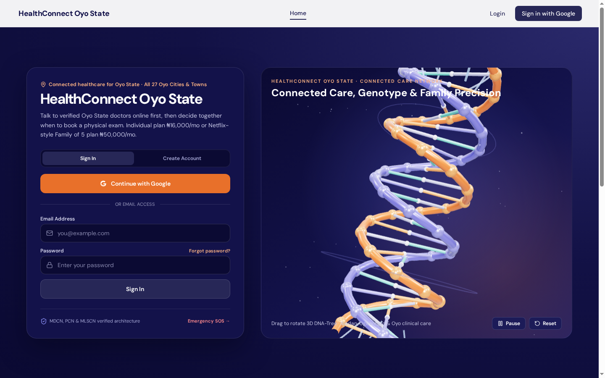
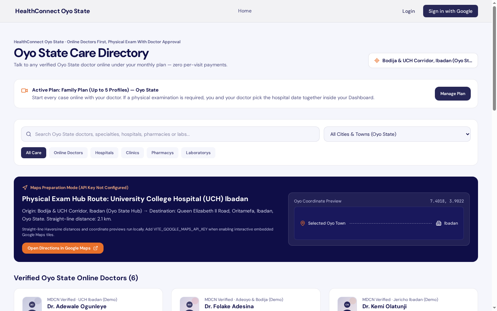
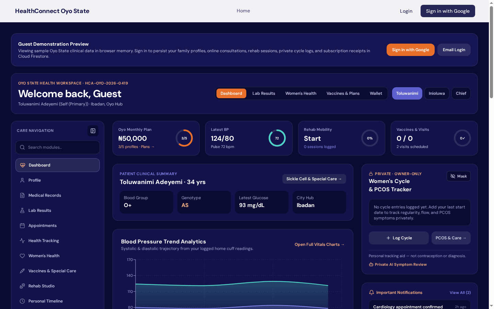
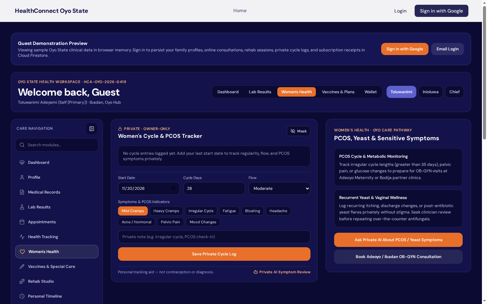
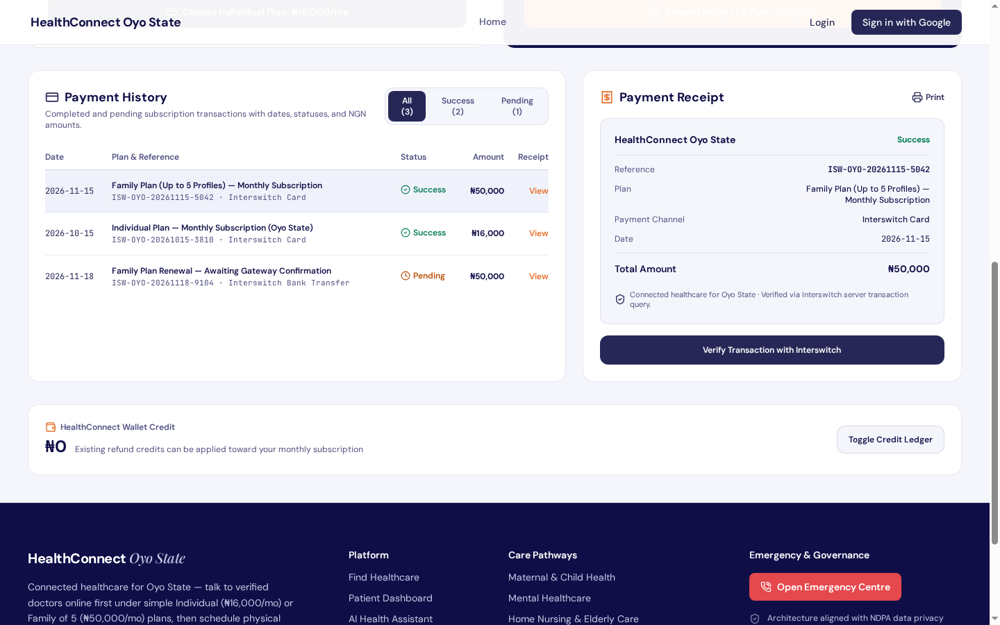
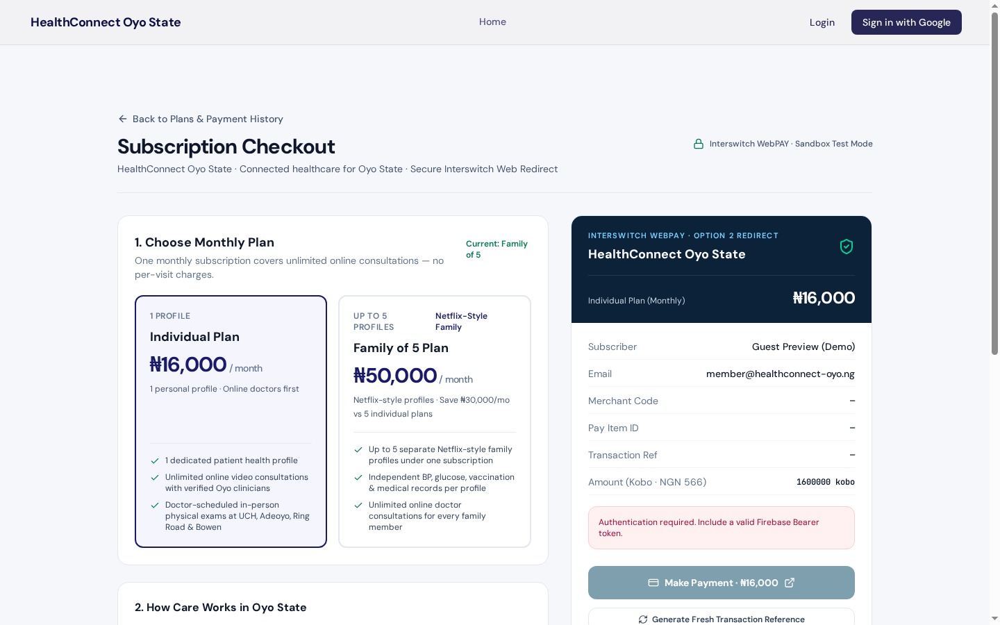
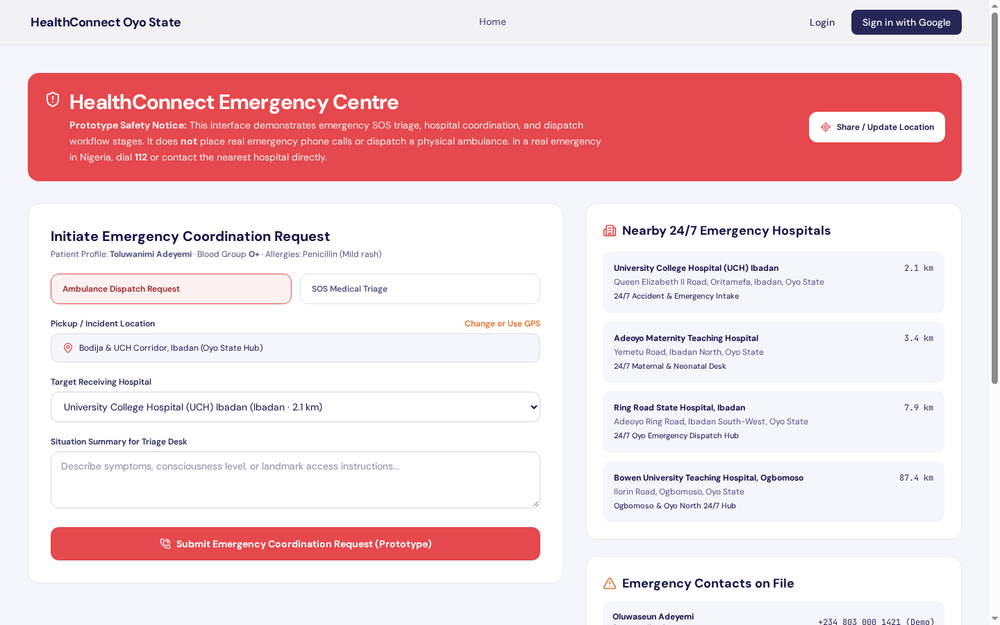

# HealthConnect Oyo State

> **Connected healthcare for Oyo State** — Subscription-based digital healthcare across all 27 major cities and towns in Oyo State, Nigeria.

HealthConnect Oyo State is a full-stack digital health platform built specifically for individuals and families living in Oyo State. Instead of unpredictable per-visit fees, members subscribe to one monthly plan (**₦16,000/month Individual** or **₦50,000/month Family of 5 with Netflix-style profiles**), **consult verified Oyo State doctors online first at ₦0 per visit**, and **decide jointly with their doctor when to book an in-person physical examination** at an accredited Oyo State hospital.

---

## Table of Contents

1. [Visual Tour & Presentation Screenshots](#1-visual-tour--presentation-screenshots)
2. [Core Product Model & Care Journey](#2-core-product-model--care-journey)
3. [Progressive Web App (PWA) & Mobile Installation (Android, iOS & Desktop)](#3-progressive-web-app-pwa--mobile-installation-android-ios--desktop)
4. [Hybrid AI Architecture (Firebase AI Logic + Offline Health Library + Cloud AI)](#4-hybrid-ai-architecture-firebase-ai-logic--offline-health-library--cloud-ai)
5. [Oyo State Geographic Coverage (All 27 Towns & Partner Facilities)](#5-oyo-state-geographic-coverage-all-27-towns--partner-facilities)
6. [Subscription Plans & Netflix-Style Family Profiles](#6-subscription-plans--netflix-style-family-profiles)
7. [Complete Website Pages & Routes (12 Routes)](#7-complete-website-pages--routes-12-routes)
8. [Patient Dashboard Modules (All 15 Tabs)](#8-patient-dashboard-modules-all-15-tabs)
9. [Interswitch Option 2 (Web Redirect) Payment Architecture](#9-interswitch-option-2-web-redirect-payment-architecture)
10. [Technology Stack & Project Structure](#10-technology-stack--project-structure)
11. [Backend REST API Reference](#11-backend-rest-api-reference)
12. [Cloud Firestore Database Blueprint (21 Collections)](#12-cloud-firestore-database-blueprint-21-collections)
13. [Security, Privacy (NDPA-Informed), RBAC & Clinical Guardrails](#13-security-privacy-ndpa-informed-rbac--clinical-guardrails)
14. [Environment Variables](#14-environment-variables)
15. [Local Development, Testing & Production Deployment](#15-local-development-testing--production-deployment)
16. [Demonstration Data & Clinical Safety Notice](#16-demonstration-data--clinical-safety-notice)

---

## 1. Visual Tour & Presentation Screenshots

Every screenshot below is captured directly from the live **HealthConnect Oyo State** application (all 14 high-resolution PNG files live in `public/screenshots/`).

### 1.1 Landing Hero & Interactive 3D DNA Double Helix (`/`)


### 1.2 Home Oyo State Care Directory Strip (`/`)


### 1.3 Oyo State Care Directory — All 27 Towns & Online Doctors First (`/find-healthcare`)


### 1.4 Midnight Blue Eclipse Patient Dashboard Overview (`/dashboard`)


### 1.5 Netflix-Style Family Profiles Hub — "Who's Accessing Care?" (Up to 5 Seats)


### 1.6 Online Consultations & Doctor-Scheduled Physical Exam Booking


### 1.7 Women's Health — Private Cycle Tracker & PCOS Care Pathway


### 1.8 Rehabilitation Progress Studio — Guided Timer & Recovery Charts


### 1.9 Monthly Subscription Plans — Individual (₦16,000/mo) & Family of 5 (₦50,000/mo) (`/payments`)


### 1.10 Payment History & Printable Interswitch Receipts (`/payments`)


### 1.11 Dedicated Interswitch Option 2 (Web Redirect) Checkout (`/checkout`)


### 1.12 Blood Pressure & Blood Glucose Monitoring (`/monitoring`)


### 1.13 AI Health Information Assistant & Interactive Anatomy Explorer (`/ai-assistant`)


### 1.14 24/7 Oyo State Emergency & Ambulance Triage Centre (`/emergency`)


---

## 2. Core Product Model & Care Journey

HealthConnect Oyo State removes financial friction at the point of care by pairing a **subscription-only billing model** with an **online-first clinical workflow**:

```text
1. Subscribe Monthly (₦16,000 Individual or ₦50,000 Family of 5 via Interswitch Web Redirect)
        │
        ▼
2. Talk to a Verified Oyo State Doctor Online (₦0 per consultation — included in plan)
        │
        ▼
3. Doctor & Patient Jointly Decide If an In-Person Physical Examination Is Needed
        │
        ├──► Stay Online: Digital care plan, prescriptions, vitals & rehab tracking
        └──► Schedule Physical Exam: Seamless booking at UCH Ibadan, Adeoyo,
             Ring Road State Hospital, Jericho Specialist, or Bowen Ogbomoso
```

### Key Differentiators
- **Subscription-Only Payments:** All per-visit doctor charges, standalone lab package checkouts, pharmacy refill checkouts, equipment rental payments, and standalone wallet top-up checkouts have been removed.
- **Netflix-Style Family Profiles:** One ₦50,000/month Family Plan covers up to **5 separate household members** with a visual **"Who's accessing care?"** profile picker, live seat tracking (`X of 5 profiles used`), and isolated clinical records per person.
- **Oyo State Exclusive Focus:** Defaulting to **Ibadan** and covering **all 27 major Oyo State cities and towns**, every hospital, doctor, emergency route, and location preset is tailored to Oyo State.
- **Transparent Payment History:** Dedicated tracking of every subscription payment with **All / Success / Pending** filters, dates, references, NGN amounts, server verification buttons, and printable receipts.

---

## 3. Progressive Web App (PWA) & Mobile Installation (Android, iOS & Desktop)

HealthConnect Oyo State is an installable, mobile-first Progressive Web App powered by `vite-plugin-pwa` (Workbox) with a privacy-strict caching policy:

- **Web App Manifest (`/manifest.webmanifest`):**
  - `name`: `HealthConnect Oyo State` | `short_name`: `HealthOyo`
  - `display`: `standalone` | `theme_color`: `#0F0E47` | `background_color`: `#0B0A33`
  - Dedicated crisp icons in `/public/`: `icon.svg`, `pwa-192x192.png`, `pwa-512x512.png`, `pwa-maskable-512x512.png` (maskable safe-zone), and `apple-touch-icon.png` (180×180 for iOS Safari).
- **Privacy-Strict Service Worker:**
  - Precaches the app shell, CSS, JS, and offline WHO & Nigeria Health Reference Library for instant offline loading (excludes large presentation screenshots from precache).
  - Enforces `NetworkOnly` for `/api/*`, `/payment-response`, `firestore.googleapis.com`, `identitytoolkit.googleapis.com`, `securetoken.googleapis.com`, and `interswitchng.com` so authenticated patient data and payments are **never** cached in Service Worker Cache Storage.
- **Mobile-First Navigation:** Compact fixed bottom thumb-zone navigation (`MobileBottomNav`) on screens `<768px`, offline status banner (`OfflineIndicator`), and an in-app `Install App` button (`PWAInstallButton`) that triggers native install on Chrome/Edge/Android or displays step-by-step instructions on iOS Safari.

### How to Install on Your Device
- **Android (Chrome / Edge / Samsung Internet):** Open the site, tap **Install App** in the top bar (or browser menu **⋮ → Add to Home screen / Install app**), then launch **HealthOyo** directly from your home screen.
- **iPhone / iPad (Safari):** Open the site in Safari, tap the **Share** button (`↑`), scroll down and tap **Add to Home Screen**, then tap **Add**.
- **Desktop (Chrome / Edge):** Click **Install App** in the navigation bar or the install icon in the browser address bar.

---

## 4. Hybrid AI Architecture (Firebase AI Logic + Offline Health Library + Cloud AI)

Built to work reliably on low-bandwidth Nigerian mobile networks and eligible for **#BuildHybridAI 2026**, HealthConnect Oyo State runs **one unified Hybrid AI Router** (`src/services/hybridAiRouter.ts`) that seamlessly coordinates Local AI and Cloud AI:

```text
User Question (Chat, Voice Dictation, 3D Anatomy, or Offline Health Library)
       │
       ▼
[1. Instant Local Clinical Red-Flag Detector (<1ms)]
    ├── Detects emergency signs (chest pain, stroke BE-FAST, severe bleeding, seizures, pregnancy danger)
    └── Immediately surfaces high-contrast Nigeria 112 Emergency Card (zero network delay)
       │
       ▼
[2. Curated Offline WHO & Nigeria Health Library Grounding (18 Chapters · 6 Volumes)]
    └── Weighted synonym search (bp, sugar, malaria RDT, ACT, PCOS, genotype SS, ORS, HbA1c, stroke)
       │
       ▼
[3. Unified Hybrid AI Router (Connectivity + Device Capability + Mode + NDPA Consent)]
    ├── Offline OR Local-Only Mode ──► Chrome On-Device Gemini Nano (Firebase AI Logic ONLY_ON_DEVICE)
    │                                   └──► Fallback: Curated Offline WHO/Nigeria Health Engine
    ├── Smart Hybrid (Online) ────────► On-Device Gemini Nano (PREFER_ON_DEVICE) for local-suitable tasks
    │                                   ├──► Direct Local Library for terminology / app navigation
    │                                   └──► Grounded Cloud AI (Express Backend / Firebase AI Logic Cloud)
    └── Cloud Error / Timeout ────────► Automatic Graceful Fallback to Approved Offline Health Library
```

### Offline Curated Health Reference Library (All 6 Volumes Bundled Locally & Synced to Public IndexedDB)
1. **WHO & Nigeria Primary Care Core** — Fever triage, diarrhoea & ORS/zinc, safe NAFDAC medication practices
2. **Maternal, Women's Health & PCOS** — Antenatal care & pregnancy danger signs, PCOS & cycle tracking, recurrent yeast & sensitive symptoms
3. **Chronic Care (BP, Diabetes & Sickle Cell)** — Hypertension & BP targets, Diabetes/HbA1c/glucose monitoring, Sickle Cell (HbSS/HbSC) crisis prevention
4. **Infectious Diseases & Vaccines** — Malaria RDT & ACT protocol, Typhoid & safe water hygiene, Lassa Fever & Nigeria Routine Immunization (NPI)
5. **Emergency First Aid & Red Flags** — Stroke BE-FAST, Chest pain & cardiac arrest response, Severe bleeding/burns/seizures & Nigeria `112`
6. **Medical Terms, Labs & App Guide** — Plain-language lab glossary (HbA1c, lipid panel, PCV, genotype), Medical terms dictionary, HealthConnect Oyo navigation guide

### Offline vs. Online Feature Matrix
| Category | Feature Behavior |
| --- | --- |
| **Fully Offline** | 18-chapter WHO & Nigeria Health Library search & reader, Local AI educational answers, Instant Red-Flag Emergency Alerts, On-device Gemini Nano (supported Chrome), Guide bookmarks (public IndexedDB) |
| **Partially Available** | Previously opened app views cached by the Service Worker; cached UI shell |
| **Internet-Dependent** | Online Cloud AI deeper reasoning (Gemini/OpenRouter/Firebase AI Cloud), Cloud Firestore record sync, Doctor bookings, Interswitch payments, Live Maps, SOS dispatch |

---

## 5. Oyo State Geographic Coverage (All 27 Towns & Partner Facilities)

### All 27 Supported Cities, Towns & Care Corridors
| Zone / Corridor | Covered Towns & Hubs |
| --- | --- |
| **Ibadan Metro (6)** | Ibadan (Bodija & UCH Corridor), Ring Road Ibadan (Oluyole), Jericho & Dugbe Ibadan, Akobo & Iwo Road Ibadan, Challenge & Molete Ibadan, Moniya (Akinyele) |
| **Ogbomoso & Oyo Central (6)** | Ogbomoso (Bowen & Takie Axis), Oyo Town (Atiba/Durbar/Owode), Fiditi (Afijio), Ilora, Awe, Jobele (Afijio LGA HQ) |
| **Oke-Ogun Region (10)** | Iseyin, Saki, Igboho (Oorelope), Kishi (Irepo), Okeho (Kajola), Tede (Atisbo), Igbeti (Olorunsogo), Otu (Itesiwaju), Ago-Are, Sepeteri |
| **Ibarapa & Lagelu (5)** | Eruwa (Ibarapa East), Igbo-Ora (Ibarapa Central), Lanlate, Ayete (Ibarapa North), Lalupon (Lagelu East) |

### Partner Oyo State Facilities
- **University College Hospital (UCH) Ibadan** — Cardiology, Sickle Cell & Haematology, Emergency Trauma, 24/7 ICU & A&E
- **Adeoyo Maternity Teaching Hospital, Yemetu** — Maternal & OB-GYN, PCOS Clinic, Paediatrics, Immunizations (24/7 Maternal Desk)
- **Ring Road State Hospital, Ibadan** — Internal Medicine, Emergency Triage, Diabetes Clinic, Surgery (24/7 Dispatch Hub)
- **Bowen University Teaching Hospital, Ogbomoso** — Family Medicine, Orthopaedics & Rehab, Diagnostics, Maternal Care (24/7 Oyo North Hub)
- **HealthConnect Partner Pharmacy — Bodija, Ibadan** — PCN-licensed & NAFDAC-compliant, cold-chain insulin
- **Bodija & Jericho Diagnostic Pathology Lab** — MLSCN & ISO 15189 partner (Genotype, Sickle Cell, HbA1c, home phlebotomy)

### Verified Oyo State Specialist Clinicians (Demo Roster)
- **Dr. Adewale Ogunleye** — Cardiology & Hypertension (UCH Ibadan)
- **Dr. Folake Adesina** — Obstetrics, Gynaecology & PCOS (Adeoyo Maternity Teaching Hospital)
- **Dr. Kemi Olatunji** — Paediatrics, Vaccines & Sickle Cell (Jericho Specialist Hospital, Ibadan)
- **Dr. Samuel Oladele** — Family & General Medicine (Bowen University Teaching Hospital, Ogbomoso)
- **Dr. Ibrahim Danjuma** — Internal Medicine & Diabetes (Ring Road State Hospital, Ibadan)
- **Dr. Tunde Bakare** — Clinical Psychology & Mental Health (Bodija Serene Mind Clinic & Telehealth)

---

## 6. Subscription Plans & Netflix-Style Family Profiles

| Plan | Server Order ID | Price | Seats | What's Included |
| --- | --- | --- | --- | --- |
| **Individual Plan — Oyo State** | `plan-oyo-individual-monthly` | **₦16,000 / month** (`1,600,000` kobo) | **1 Profile** | Unlimited online doctor visits (`₦0`), doctor-booked physical exams at partner Oyo hospitals, vitals & medical records, AI Health Assistant, 24/7 Oyo emergency routing |
| **Family Plan (Up to 5 Profiles)** | `plan-oyo-family-monthly` | **₦50,000 / month** (`5,000,000` kobo) | **Up to 5 Profiles** | **Save ₦30,000/month** vs. 5 individual plans. Netflix-style **"Who's accessing care?"** 5-slot household grid, isolated BP/glucose/vaccine/medical records per member, inline profile creation across 27 Oyo towns, one monthly Interswitch payment |

### Netflix-Style Family Hub (`NetflixFamilyHub`)
Inside **Dashboard → Family Profiles**:
- Visual 5-slot avatar card grid showing each family member's name, relationship (`Self (Primary)`, `Child Dependent`, `Parent`), Oyo town, blood group, and genotype.
- Live seat meter (`X of 5 family profiles used`).
- One-click profile switching that dynamically scopes all Dashboard charts, appointments, records, reminders, and vitals to the chosen household member.
- Automatic seat enforcement: users on the 1-seat Individual Plan see a direct upgrade prompt to `/checkout` for the ₦50,000/month Family Plan when attempting to add additional profiles.

---

## 7. Complete Website Pages & Routes (12 Routes)

| Route | Auth Required | Component | Description |
| --- | --- | --- | --- |
| `/` | Public | `HeroSection` + `DedicatedCareDirectoryStrip` | Full-bleed Midnight Blue Eclipse hero, interactive 3D showcase, quick-launch actions, and 4-card Oyo State care strip |
| `/login` | Public | `AuthPage` + `DnaHelix3D` | Google Sign-In, Email/Password sign-in, password reset, and interactive Three.js 3D DNA double-helix |
| `/register` | Public | `AuthPage` + `DnaHelix3D` | Account registration with Oyo State town picker (all 27 towns) and Firebase email verification |
| `/find-healthcare` | Authenticated | `FindHealthcarePage` | Oyo State Care Directory filtered by town, specialty, and telehealth with inline **Online Doctor Consultation** booking drawer (`₦0/visit`) |
| `/dashboard` | Authenticated | `DashboardPage` | Full care command center with collapsible left sidebar, radial KPI rings, Recharts analytics, and 15 clinical tabs |
| `/payments` | Authenticated | `PaymentsPage` | Monthly subscription plan cards (`₦16k` & `₦50k`), active plan status, and dedicated **Payment History** section (`All` / `Success` / `Pending` filters, dates, status badges, amounts, server verification, printable receipts) |
| `/checkout` | Authenticated | `CheckoutPage` | Dedicated **Interswitch Option 2 — Web Redirect** checkout page with plan toggle, server-generated reference, official HTML `<form method="post">` fields, Verve sandbox test card guide, and wallet credit redemption |
| `/payment-response` | Public (waits for auth) | `PaymentResponsePage` | Receives Interswitch redirect (`?txnref=...`), waits for Firebase Auth, calls server-side verification, idempotently activates subscription, saves Payment History, and renders a printable receipt |
| `/monitoring` | Authenticated | `MonitoringPage` | Blood Pressure & Blood Glucose tracking workspace with cuff/glucometer entry forms, Recharts trend graphs, clinical guidance, and CSV vitals report download |
| `/ai-assistant` | Authenticated | `AiAssistantPage` | 5-mode non-diagnostic AI Health Information Assistant, interactive 3D anatomy selector, Web Speech API voice input, Gemini / OpenRouter model switcher, and saved consultation history |
| `/emergency` | Authenticated | `EmergencyPage` | Prototype Oyo State Emergency & Ambulance Triage desk, GPS / manual 27-town locator, Haversine nearest-hospital distance sorting, 4-stage SOS tracker (`submitted` → `accepted` → `dispatched` → `resolved`), and explicit Nigeria **112** notice |
| `/about` | Authenticated | `AboutPage` | Mission statement, 27-town Oyo State footprint, Online-First clinical workflow, and subscription overview |

---

## 8. Patient Dashboard Modules (All 15 Tabs)

1. **Dashboard (Overview)** — 4-column radial KPI strip (Oyo Monthly Plan & profile seats, Latest BP, Rehab Mobility, Vaccines & Visits), patient identity summary, dark-mode BP area chart, and medication reminders widget.
2. **Profile** — Full personal & clinical identity editor (name, age, gender, Oyo town, blood group, genotype, allergies, HMO/NHIA, medical history summary) plus isolated private contact PII (phone & residential address).
3. **Medical Records** — Log conditions, lab reports, imaging, immunizations, discharge summaries, and prescriptions; upload compressed clinical photos with lightbox inspection; share individual records with a verified doctor UID.
4. **Lab Results** — Structured MLSCN partner pathology panels (HbA1c, lipid profile, genotype) with reference ranges and one-click handoff to AI Test Review.
5. **Appointments** — View online telehealth and in-person visits (`Included in Plan` at `₦0`), cancel/reschedule, and click **Schedule Physical Exam** on any online consultation to book an in-person exam at UCH Ibadan, Adeoyo Maternity, Ring Road State Hospital, Jericho Specialist, or Bowen Ogbomoso.
6. **Health Tracking (Vitals)** — Chronological blood pressure & blood glucose charts and entry logs per family profile.
7. **Women's Health** — Private owner-only `CycleTrackerCard` (start date, cycle length, flow intensity, symptoms) paired with PCOS, recurrent yeast & sensitive symptom guidance and direct OB-GYN consultation links.
8. **Vaccines & Special Care** — Age-grouped immunization tracker (`0–5`, `10–15`, `15+`), sickle cell & genotype preventive care hub, and monthly plan quick-upgrade cards.
9. **Rehab Studio** — Clinician-approved home physiotherapy catalogue, live session countdown timer, pain (`0–10`) & mobility (`1–10`) logger, Recharts recovery trajectory chart, clinician UID sharing, and `₦0` online physiotherapy follow-up booking.
10. **Personal Timeline** — Unified chronological feed combining appointments, vitals, labs, documents, immunizations, and rehab sessions.
11. **Health Wallet** — Credit/refund balance and append-only ledger (standalone wallet top-up checkouts removed; existing balance can be redeemed on `/checkout`).
12. **Medication Reminders** — Create, pause/resume, and mark-taken daily/weekly medication, BP, glucose, and hydration reminders.
13. **Family Profiles** — Netflix-style **"Who's accessing care?"** 5-slot household hub (`NetflixFamilyHub`).
14. **Alerts & SOS** — Emergency contact management and in-app clinical notifications.
15. **Settings & Roles** — Email verification status/resend, SMS OTP verification test, Doctor/Hospital credential verification application, and Administrator payment & role-request review console.

---

## 9. Interswitch Option 2 (Web Redirect) Payment Architecture

HealthConnect Oyo State implements Interswitch's official **Option 2 — Web Redirect** workflow, ensuring payment card details never touch the HealthConnect server or Firestore.

### How Checkout Works End-to-End
1. **Server-Authoritative Initialization (`POST /api/payments/interswitch/initialize`):**
   - Frontend sends `{ orderId: "plan-oyo-individual-monthly" | "plan-oyo-family-monthly", siteRedirectUrl: "<origin>/payment-response" }` with a Firebase ID Bearer token.
   - Server ignores any client-submitted price and looks up the authoritative catalog price (**₦16,000 → `1600000` kobo** or **₦50,000 → `5000000` kobo**), generates a unique `ISW-OYO-...` reference, and returns safe form fields.
2. **Official HTML `<form method="post">` Redirect on `/checkout`:**
   - **Sandbox action URL:** `https://newwebpay-sandbox.interswitchng.com/collections/w/pay`
   - **Production action URL:** `https://newwebpay.interswitchng.com/collections/w/pay`
   - **Submitted Form Fields:**
     - `merchant_code` (defaults to official public sandbox `MX6072` in sandbox mode; strictly requires `INTERSWITCH_MERCHANT_CODE` in production)
     - `pay_item_id` (defaults to official public sandbox `9405967` in sandbox mode; strictly requires `INTERSWITCH_PAY_ITEM_ID` in production)
     - `site_redirect_url` (`<origin>/payment-response`)
     - `txn_ref` (`ISW-OYO-...`)
     - `amount` (in kobo: `1600000` or `5000000`)
     - `currency` (`566` for Nigerian Naira)
     - `cust_id`, `cust_name`, `cust_email`, `pay_item_name`
3. **POST Return Handler (`POST /payment-response`):**
   - Express parses Interswitch's `application/x-www-form-urlencoded` callback and responds with **HTTP `303 See Other`** redirecting to `/payment-response?txnref=...&resp=...&desc=...&payRef=...`.
4. **Server-to-Server Verification (`GET /api/payments/interswitch/verify/:transactionReference`):**
   - `PaymentResponsePage` waits for Firebase Auth hydration, calls the verification endpoint, and the server queries Interswitch's `gettransaction.json` API directly to validate `ResponseCode === "00"`, exact kobo amount, and currency `566`.
   - Verified payments idempotently activate the monthly plan, record a `Verified` entry in Firestore `/transactions` (displayed in **Payment History**), and display a printable receipt.
5. **HMAC-SHA512 Webhooks (`POST /api/webhooks/interswitch`):**
   - Validates `X-Interswitch-Signature` over the raw request body using timing-safe comparison and deduplicates replay deliveries.

### Official Interswitch Sandbox Test Card (For Testing `/checkout`)
- **Merchant Code:** `MX6072` *(auto-configured in sandbox)*
- **Pay Item ID:** `9405967` *(auto-configured in sandbox)*
- **Verve Test Card:** `5061050254756707864`
- **Expiry:** Any future date (e.g. `12/28`)
- **CVV:** `111` | **PIN:** `1111` | **OTP:** `123456`

---

## 10. Technology Stack & Project Structure

### Stack
- **Frontend:** React 19, TypeScript, Vite 8, Tailwind CSS v4 (`@tailwindcss/vite`), Lucide React, Motion
- **3D & Charts:** Three.js, `@react-three/fiber`, `@react-three/drei`, Recharts 3
- **Backend:** Node.js, Express 4 (`server.ts` / `server/createApp.ts`), TSX, Zod 4
- **Auth & Database:** Firebase Authentication, Cloud Firestore (`firebase` v13, `firebase-admin` v14)
- **AI Gateway:** `@google/genai` (Gemini) + OpenRouter server-side proxy
- **Testing & Linting:** Vitest 5, ESLint 10, `@firebase/eslint-plugin-security-rules`, TypeScript (`tsc --noEmit`)

### Directory Layout
```text
├── index.html                           # HTML entry point & SEO/OpenGraph metadata
├── server.ts                            # Express + Vite dev/prod HTTP entrypoint (port 3000)
├── firebase-blueprint.json              # Authoritative 21-collection Firestore schema blueprint
├── firestore.rules                      # Owner-only & 4-tier RBAC Firestore security rules
├── public/
│   ├── screenshots/                     # 14 high-resolution presentation & README screenshots
│   └── assets/aistudio/                 # Interactive Anatomy Explorer reference images
├── server/
│   ├── createApp.ts                     # Express app factory, security headers, CORS, rate limits
│   ├── config/env.ts                    # Environment parsing & Interswitch sandbox/prod config
│   ├── middleware/                      # Firebase ID token auth, Admin RBAC, security headers
│   ├── routes/                          # healthRoutes, aiRoutes, paymentRoutes, verificationRoutes
│   ├── services/                        # aiGateway, paymentService, paymentStore, auditService
│   └── validators/schemas.ts            # Zod request validation schemas
├── src/
│   ├── App.tsx                          # SPA router & auth gate shell
│   ├── context/AppContext.tsx           # Global auth, Firestore subscriptions, plans & booking actions
│   ├── data/mockNigeriaData.ts          # 27 Oyo towns, ₦16k/₦50k plans, demo Oyo clinicians/hospitals
│   ├── services/                        # apiClient.ts & firestoreService.ts
│   ├── types/healthcare.ts              # Shared TypeScript interfaces
│   ├── pages/                           # 10 full pages (Dashboard, FindHealthcare, Payments, Checkout, PaymentResponse, Auth, AiAssistant, Monitoring, Emergency, About)
│   └── components/                      # Modular UI (NetflixFamilyHub, AppointmentHistory, MedicalRecords, RehabilitationStudio, CycleTrackerCard, SpecialCareHub, HealthWallet, DnaHelix3D, etc.)
└── tests/
    ├── backend.api.test.ts              # Health, auth 401s, AI validation, Interswitch sandbox defaults
    ├── interswitch.and.security.test.ts # 14+ Interswitch Web Redirect, anti-tampering, webhook & RBAC tests
    └── rbac.and.rules.test.ts           # Firestore security rules & RBAC checks
```

---

## 11. Backend REST API Reference

| Method & Endpoint | Auth / Rate Limit | Description |
| --- | --- | --- |
| `GET /api/health` | Public | Liveness check & boolean provider readiness (never leaks secrets) |
| `GET /api/config/integrations` | Public | Safe boolean integration flags (`interswitchConfigured`, `interswitchUsingPublicSandboxDefaults`, `geminiConfigured`, etc.) |
| `POST /api/ai/health-assistant` | Optional Auth · `30/min` | Server-side Gemini / OpenRouter clinical information proxy with safety system prompt |
| `POST /api/payments/interswitch/initialize` | Firebase Auth · `30/min` | Resolves server catalog price (`₦16k` / `₦50k`), generates `ISW-OYO-...` ref, returns Web Redirect URL & POST fields |
| `POST /payment-response` | Public (Form POST) | Receives Interswitch Option 2 Web Redirect return and issues `303 See Other` to `/payment-response?txnref=...` |
| `GET /api/payments/interswitch/verify/:ref` | Firebase Auth · `30/min` | Server-to-server Interswitch verification (code `00`, exact kobo amount, NGN `566`, idempotent replay safe) |
| `POST /api/webhooks/interswitch` | HMAC-SHA512 · `60/min` | Verifies `X-Interswitch-Signature` over raw body and deduplicates webhook deliveries |
| `GET /api/admin/payments` | Verified Admin · `30/min` | Administrator-only payment ledger and reconciliation summary |
| `POST /api/payments/initialize` & `/verify` | Firebase Auth · `30/min` | Backwards-compatible payment endpoints |
| `POST /api/verification/sms/send` & `/verify` | Firebase Auth · `30/min` | SMS OTP verification endpoints (Termii/Twilio ready; returns `503` if unconfigured) |

---

## 12. Cloud Firestore Database Blueprint (21 Collections)

All collections are formally defined in `firebase-blueprint.json` and enforced by `firestore.rules`:

- **Identity & RBAC:** `/users/{userId}`, `/users/{userId}/private/{docId}` (isolated PII), `/admins/{adminId}`, `/roleRequests/{requestId}`
- **Family & Clinical Data:** `/familyProfiles/{profileId}`, `/bpReadings/{readingId}`, `/glucoseReadings/{readingId}`, `/medicalDocuments/{docId}`, `/appointments/{appointmentId}`, `/rehabSessions/{sessionId}`, `/cycleLogs/{logId}` *(strictly owner-only)*, `/vaccinationRecords/{recordId}`, `/medicationReminders/{reminderId}`, `/aiConsultations/{consultationId}`
- **Emergency & Audit:** `/emergencyRequests/{requestId}`, `/emergencyContacts/{contactId}`, `/auditLogs/{logId}` *(append-only)*
- **Payments & Billing:** `/transactions/{txId}` *(Payment History)*, `/walletTransactions/{entryId}` *(append-only)*, `/payments/{paymentId}`, `/webhookEvents/{eventId}` *(admin read-only)*

---

## 13. Security, Privacy (NDPA-Informed), RBAC & Clinical Guardrails

- **NDPA-Informed AI Consent & Data Minimization:** Users receive a clear one-time Privacy & Consent Notice (`AiConsentModal`) before enabling optional Cloud AI profile context, plus a persistent per-chat toggle and 1-click consent revocation. When enabled, only a minimized clinical summary (age, Oyo town, blood group, genotype, latest BP/glucose/lab summary) is sent—never full name, phone number, address, or payment credentials.
- **Zero Sensitive Offline Caching:** Service Worker rules strictly enforce `NetworkOnly` on `/api/*`, Firestore, Firebase Auth, and Interswitch endpoints. IndexedDB (`healthconnect-oyo-public-v1`) stores ONLY public educational guides, guide bookmarks, and non-sensitive UI preferences—never patient records or PII.

- **4-Tier RBAC:** `patient`, `doctor`, `hospital`, and `administrator` roles enforced across both Express middleware and Cloud Firestore rules.
- **Owner-Only Privacy & Explicit Consent:** Private PII (`/users/{uid}/private`), women's health & PCOS logs (`/cycleLogs`), and health records are accessible only to the owning user unless explicitly shared per record via `sharedWithDoctorUid`.
- **Zero Card Storage & Anti-Tampering:** Card PANs, CVVs, PINs, and Interswitch secrets are never stored in Firestore or shipped to the browser; all subscription amounts are computed server-side by `orderId`.
- **Enterprise HTTP Hardening:** Strict Content-Security-Policy, `X-Content-Type-Options: nosniff`, `Referrer-Policy`, `Permissions-Policy`, disabled `X-Powered-By`, CORS allowlist, Zod input validation, and scoped rate limiting.
- **Clinical Responsibility:** Non-diagnostic AI disclaimers, explicit Nigeria `112` emergency prototype notices, and manual validated medical-device vitals entry.

---

## 14. Environment Variables

Copy `.env.example` to `.env` and configure secrets server-side (never commit `.env` to Git):

```bash
APP_URL=http://localhost:3000
NODE_ENV=development

# Interswitch Web Checkout (Sandbox works out-of-the-box with MX6072 / 9405967)
# For production, set INTERSWITCH_ENVIRONMENT=production and provide real credentials:
INTERSWITCH_ENVIRONMENT=sandbox
INTERSWITCH_MERCHANT_CODE=
INTERSWITCH_PAY_ITEM_ID=
INTERSWITCH_CLIENT_ID=
INTERSWITCH_SECRET_KEY=
INTERSWITCH_CALLBACK_URL=
INTERSWITCH_WEBHOOK_SECRET=

# AI Health Assistant (Server-Side Only)
GEMINI_API_KEY=
OPENROUTER_API_KEY=

# Optional Integrations
VITE_GOOGLE_MAPS_API_KEY=
TERMII_API_KEY=
TWILIO_ACCOUNT_SID=
ADMIN_EMAILS=
```

---

## 15. Local Development, Testing & Production Deployment

```bash
# 1. Install dependencies
npm install

# 2. Run Express + Vite development server on port 3000
npm run dev

# 3. Run TypeScript type check
npm run lint

# 4. Validate Firestore security rules
npx eslint firestore.rules

# 5. Run all 20 automated API, Interswitch & RBAC tests
npm test

# 6. Build and run in production
npm run build
npm start
```

---

## 16. Demonstration Data & Clinical Safety Notice

All sample clinicians, hospital listings, demonstration patient profiles, vitals readings, emergency dispatch stages, and sandbox Interswitch payment records included in this repository are demonstration data. Before launching to live patients in Oyo State:
1. Switch `INTERSWITCH_ENVIRONMENT=production` with verified Quickteller Business / Interswitch credentials.
2. Audit `firestore.rules` and configure Firebase Authentication authorized domains.
3. Onboard verified MDCN clinicians and accredited Oyo State partner hospital referral workflows.
