# HealthConnect — Offline-First Hybrid AI Healthcare Platform

> **Accessible, private, and safety-first healthcare across every age, device, and connectivity state** — combining On-Device & Cloud Hybrid AI, deterministic Medical Red-Flag Safety Middleware, Smartwatch Web Bluetooth monitoring, Offline Emergency Medical QR IDs, Role-Based Clinical Portals (Patient, Doctor Physical Calendar, Hospital-Only Roster, and Least-Privilege Administrator), and Oyo State monthly subscriptions.

---

## Table of Contents

1. [Visual Tour & All 20 Feature Screenshots](#1-visual-tour--all-20-feature-screenshots)
2. [Administrator Account & Least-Privilege Governance](#2-administrator-account--least-privilege-governance)
3. [Demo Sandbox Accounts (Instant Evaluation)](#3-demo-sandbox-accounts-instant-evaluation)
4. [Hybrid AI Architecture, Red-Flag Middleware & Multimodal Triage](#4-hybrid-ai-architecture-red-flag-middleware--multimodal-triage)
5. [Real-Time Regex Chat Policy Filter & Sentinel Bot](#5-real-time-regex-chat-policy-filter--sentinel-bot)
6. [Age-Adaptive Dashboard & Guardian Child Safety Mode (Ages 0–12)](#6-age-adaptive-dashboard--guardian-child-safety-mode-ages-012)
7. [Smartwatch & Wearable Integration + Offline Medical ID QR Code](#7-smartwatch--wearable-integration--offline-medical-id-qr-code)
8. [Doctor Physical Consultations Calendar & Hospital-Only Doctor Roster](#8-doctor-physical-consultations-calendar--hospital-only-doctor-roster)
9. [Google Drive Project Documentation Export (.doc & Google Docs)](#9-google-drive-project-documentation-export-doc--google-docs)
10. [Progressive Web App (PWA) & Privacy-Strict Offline Caching](#10-progressive-web-app-pwa--privacy-strict-offline-caching)
11. [Oyo State Geographic Coverage (All 27 Towns) & Subscription Model](#11-oyo-state-geographic-coverage-all-27-towns--subscription-model)
12. [Interswitch Option 2 (Web Redirect) Payment Architecture](#12-interswitch-option-2-web-redirect-payment-architecture)
13. [Complete Website Routes & Dashboard Modules](#13-complete-website-routes--dashboard-modules)
14. [Technology Stack, API Reference & Firestore Blueprint](#14-technology-stack-api-reference--firestore-blueprint)
15. [Local Development, Testing & Production Deployment](#15-local-development-testing--production-deployment)

---

## 1. Visual Tour & All 20 Feature Screenshots

Every screenshot below is captured directly from the live **HealthConnect** web application (all 20 high-resolution PNG files are stored in `public/screenshots/` and embedded in the exportable Word `.doc` / Google Drive documentation file).

### 1.1 Landing Hero & Interactive 3D DNA Double Helix (`/`)


### 1.2 Home Care Pathways & Universal Directory Strip (`/`)
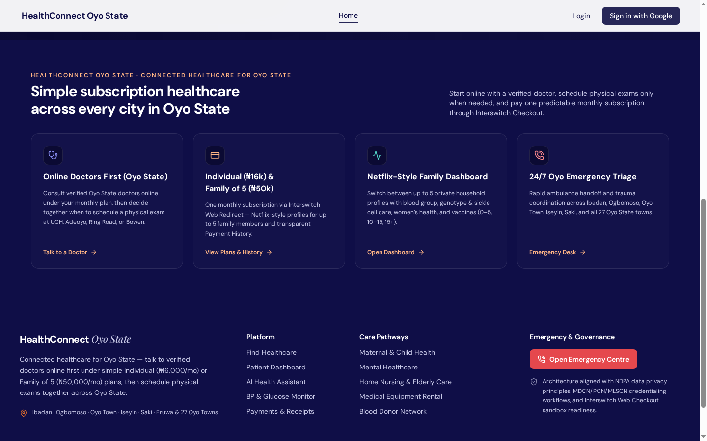

### 1.3 Authentication, Administrator Account Sign-In & Demo Sandbox Accounts (`/login`)
> Explicitly displays the verified **Admin Sign-In (Google · `amesinlolagoodluck@gmail.com`)** button alongside standard Google Sign-In, Email/Password login, and all 5 isolated Demo Sandbox Accounts.

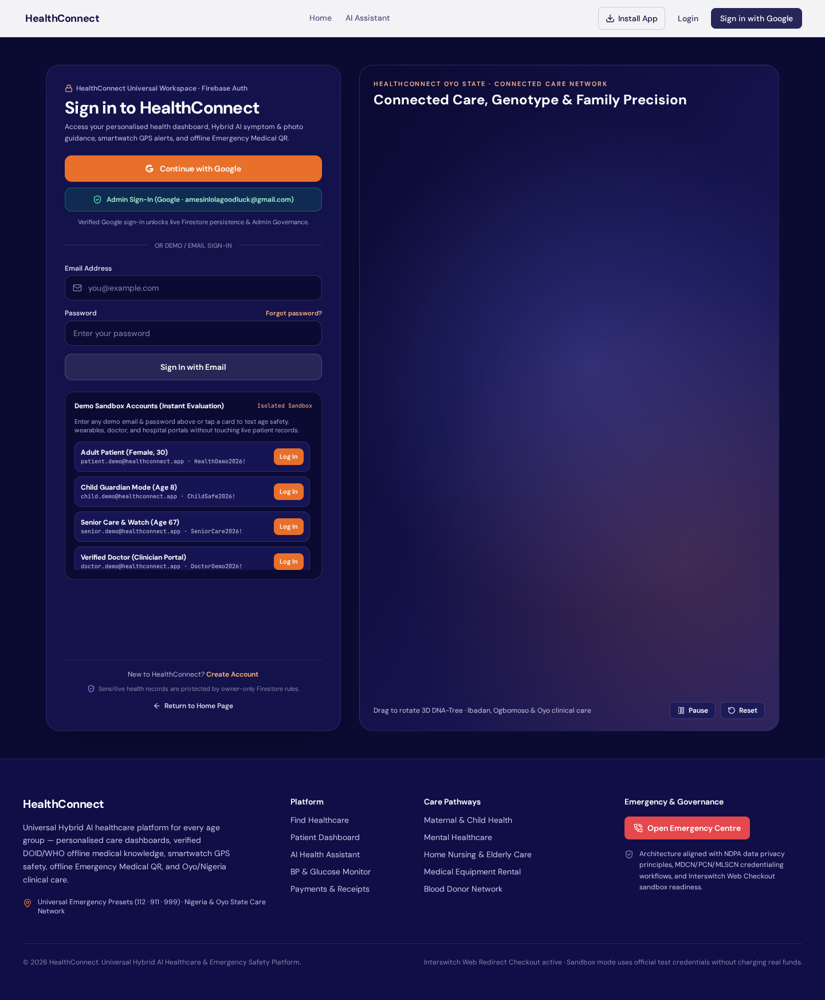

### 1.4 Oyo State Care Directory — All 27 Towns & Online Doctors First (`/find-healthcare`)


### 1.5 Midnight Blue Eclipse Patient Dashboard Overview (`/dashboard`)


### 1.6 Age-Adaptive Dashboard & Guardian Child Safety Mode — Ages 0–12 (`/dashboard`)
> Automatically locks and hides adult reproductive and adult-only health modules while activating child-safe pediatric care tools.

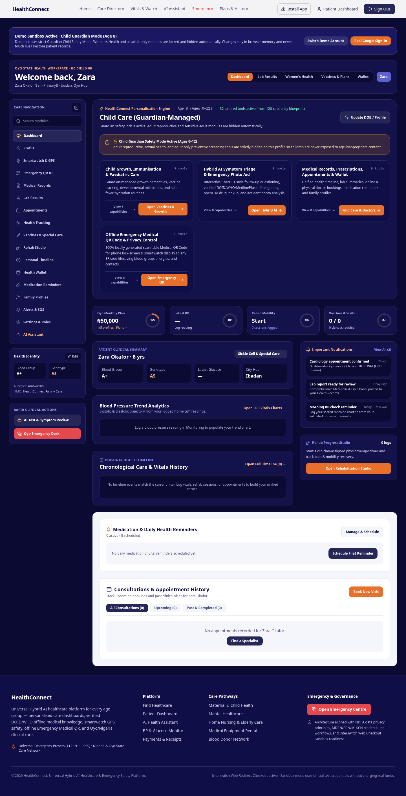

### 1.7 Netflix-Style Family Profiles Hub — "Who's Accessing Care?" (Up to 5 Seats)
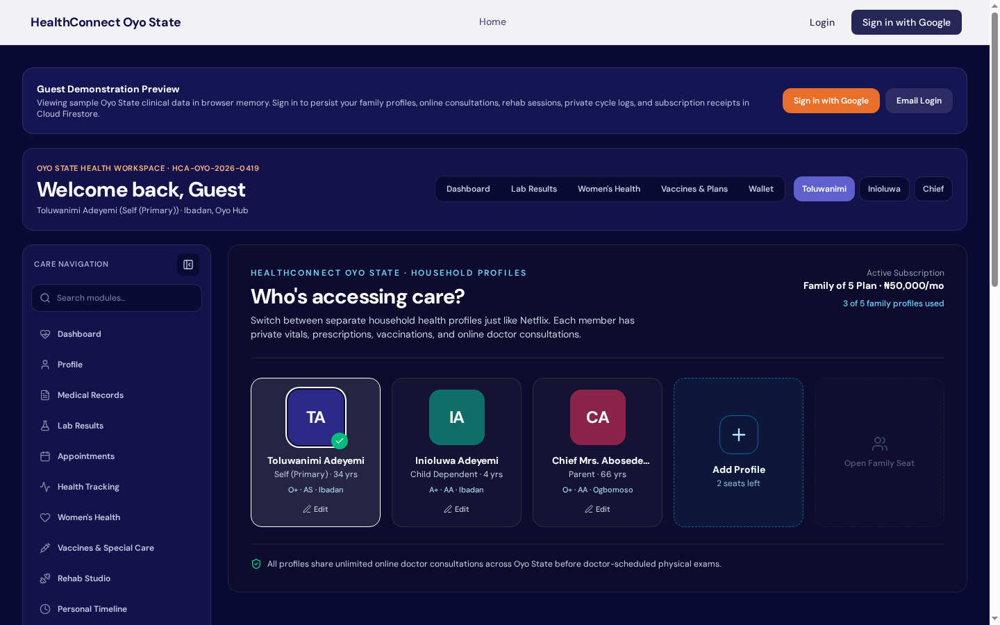

### 1.8 Online Consultations & Doctor-Scheduled Physical Exam Booking
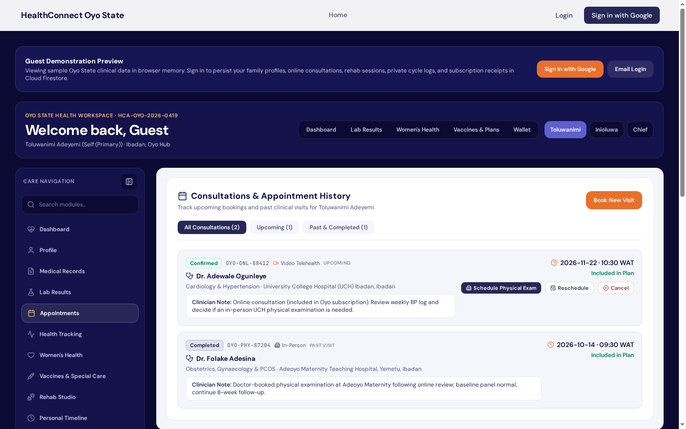

### 1.9 Verified Doctor Portal & Physical Consultations Calendar (`/dashboard → Doctor Calendar & Portal`)
> Interactive **Month Grid**, **Week Hourly Time-Slot Grid**, and **Day Agenda** showing every scheduled In-Person physical consultation synced from the booking system, with exact **From → To** times, overlap conflict alerts, clinical notes editor, and status actions.

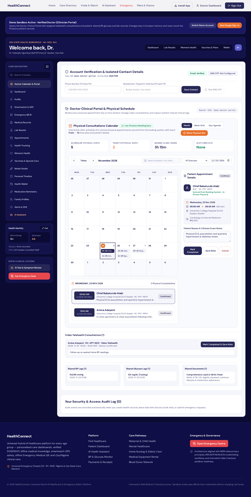

### 1.10 Partner Hospital Portal — Hospital-Only Doctor Roster & Live EMS Dispatch (`/dashboard → Hospital EMS Portal`)
> Strictly isolated by Firestore rules (`hospitalOwnerUid == request.auth.uid`) so each hospital manages **only its own doctors** alongside its active emergency ambulance dispatch queue.

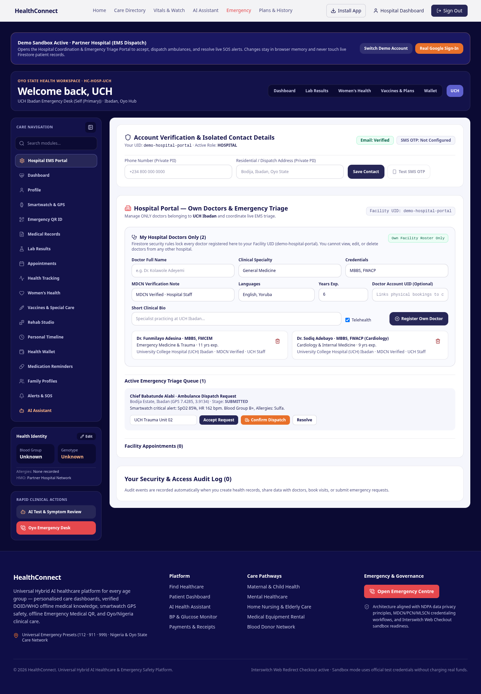

### 1.11 Hybrid AI Health Assistant, Red-Flag Safety, Photo Triage & openFDA (`/ai-assistant`)
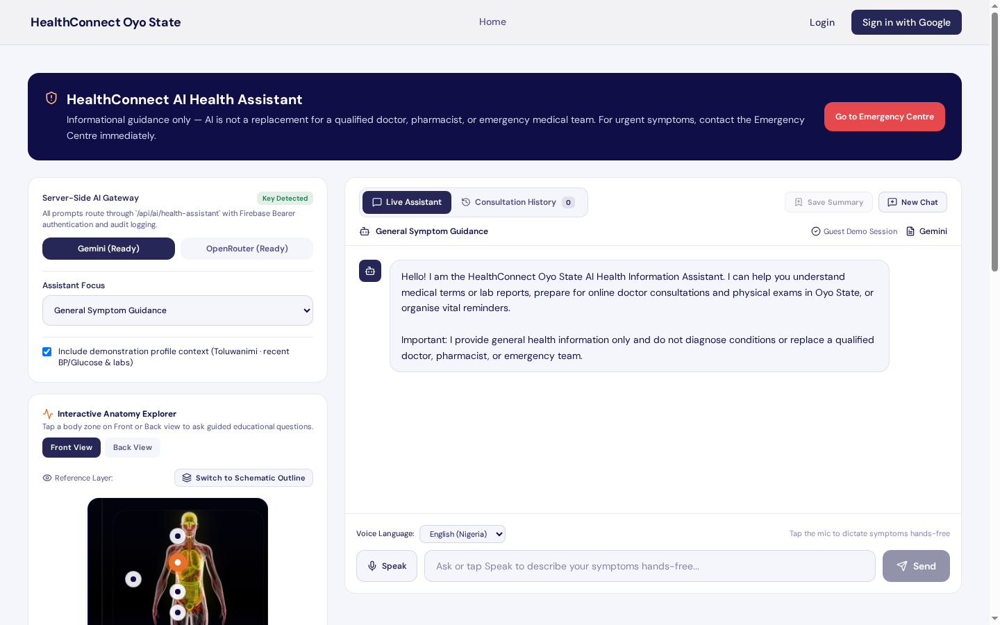

### 1.12 Smartwatch & Wearable Integration Hub — Web Bluetooth GATT & GPS Auto-SOS (`/dashboard → Smartwatch & GPS`)
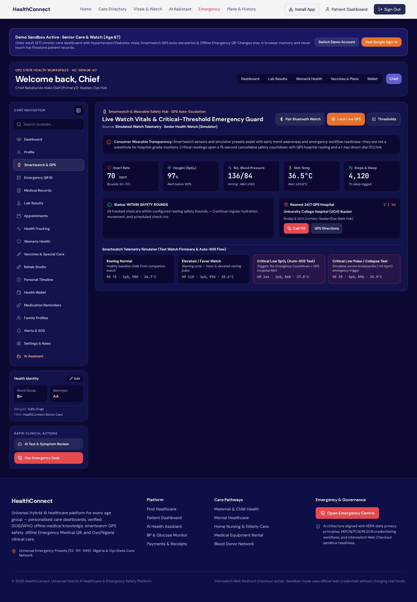

### 1.13 Offline Emergency Medical ID QR Code Generator — Zero Cloud Transfer (`/dashboard → Emergency QR ID`)
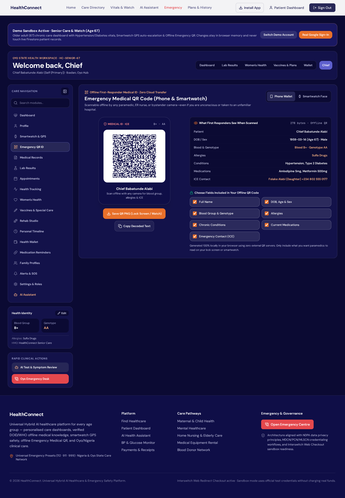

### 1.14 Blood Pressure & Blood Glucose Monitoring Studio (`/monitoring`)
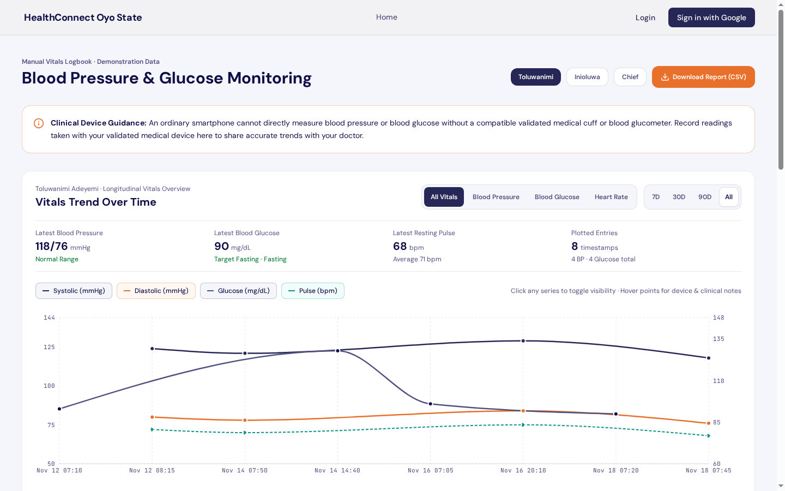

### 1.15 Women's Health — Private Cycle Tracker & PCOS Care Pathway


### 1.16 Rehabilitation Progress Studio — Guided Timer & Recovery Charts
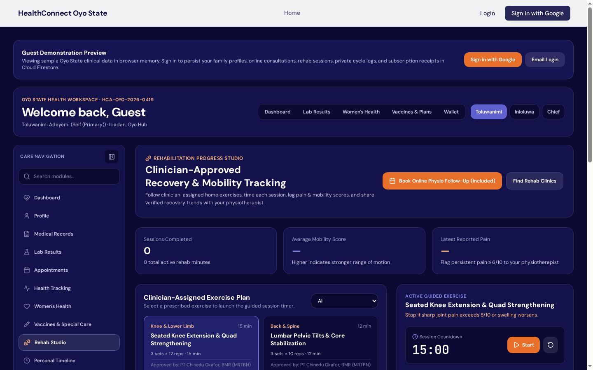

### 1.17 Monthly Subscription Plans — Individual (₦16,000/mo) & Family of 5 (₦50,000/mo) (`/payments`)
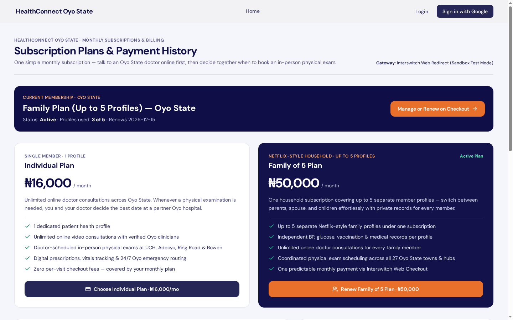

### 1.18 Payment History & Printable Interswitch Receipts (`/payments`)


### 1.19 Dedicated Interswitch Option 2 (Web Redirect) Checkout (`/checkout`)


### 1.20 24/7 Emergency & Ambulance Triage Centre (`/emergency`)


---

## 2. Administrator Account & Least-Privilege Governance

HealthConnect enforces strict least-privilege governance for the **Administrator Account**:

- **Designated Administrator Email:** `amesinlolagoodluck@gmail.com`
- **Authentication Method:** Requires live, cryptographically verified **Google Sign-In (Firebase Authentication)** with `email_verified == true`. On `/login`, click **`Admin Sign-In (Google · amesinlolagoodluck@gmail.com)`**.
- **Zero Demo Privilege Escalation:** Client-side Demo Sandbox accounts can **never** unlock Administrator privileges and never read or write live Firestore records.

### What the Administrator Account CAN and CANNOT Do (Enforced in `firestore.rules`)

| Permission Domain | Admin Access | Enforced Firestore & Backend Security Rule |
| --- | --- | --- |
| **Partner Hospitals Directory (`/hospitals`)** | **Allowed (Create / Update / Delete)** | Admin registers, edits, and manages accredited partner hospitals across the network. |
| **Partner Doctors Registry (`/partnerDoctors`)** | **Allowed (Create / Update / Delete)** | Admin registers partner doctors. Separately, verified Hospitals can create/manage **only** doctors owned by their own `hospitalOwnerUid`. |
| **Chat Policy Moderation Feed (`/chatModerationEvents`)** | **Read-Only Monitor** | Admin monitors immutable real-time regex filter & Sentinel Bot policy events (masked phone numbers, account numbers, GPS coordinates). `allow update, delete: if false`. |
| **Regular User Accounts & Private PII (`/users`, `/users/{uid}/private`)** | **Strictly Denied** | Admin cannot list, inspect, modify, or delete regular user accounts or private contact details (`allow list: if false`, owner-only `get`/`update`). |
| **Personal Medical Records & Payments** | **Strictly Denied** | Zero `isAdmin()` bypass on `familyProfiles`, `bpReadings`, `glucoseReadings`, `medicalDocuments`, `aiConsultations`, `wearableReadings`, `cycleLogs`, or `payments`. |

---

## 3. Demo Sandbox Accounts (Instant Evaluation)

For instant testing of every role and life-stage safety mode without touching live Firestore patient data, sign in on `/login` using any of these five isolated sandbox accounts (either by typing the credentials or clicking **Log In** on the Demo Sandbox card):

| Role / Account | Email | Password | Highlights |
| --- | --- | --- | --- |
| **Adult Patient (Female, 30)** | `patient.demo@healthconnect.app` | `HealthDemo2026!` | Full adult dashboard, Women's Health, Hybrid AI, Smartwatch & Offline QR |
| **Child Guardian Mode (Age 8)** | `child.demo@healthconnect.app` | `ChildSafe2026!` | Strict 0–12 Guardian Child Safety Lock hiding adult/reproductive modules |
| **Senior Care & Watch (Age 67)** | `senior.demo@healthconnect.app` | `SeniorCare2026!` | Chronic BP/Diabetes vitals, Smartwatch GPS auto-SOS & Offline Medical QR |
| **Verified Doctor (Calendar & Portal)** | `doctor.demo@healthconnect.app` | `DoctorDemo2026!` | Physical Consultations Calendar (Month/Week/Day) + patient details synced from bookings |
| **Partner Hospital (Roster & EMS)** | `hospital.demo@healthconnect.app` | `HospitalDemo2026!` | Hospital-only doctor roster (`hospitalOwnerUid`) & live Ambulance Dispatch queue |

---

## 4. Hybrid AI Architecture, Red-Flag Middleware & Multimodal Triage

HealthConnect runs a unified **Hybrid AI Router** (`src/services/hybridAiRouter.ts`) powered by Firebase AI Logic (`firebase/ai`), an Express Gemini/OpenRouter proxy, and a bundled offline medical reference engine:

- **On-Device AI:** Uses `InferenceMode.PREFER_ON_DEVICE` and `InferenceMode.ONLY_ON_DEVICE` for local Chrome Gemini Nano inference.
- **Cloud AI:** Automatically uses Gemini / OpenRouter via Express when local inference is unavailable and connectivity permits.
- **Offline Medical Engine:** Falls back to a curated 18-chapter, 6-volume medical knowledge library grounded in **DOID**, **WHO ICD-11**, **MedlinePlus**, and **openFDA Drug Lookup**.
- **Transparent Execution Badges:** Every AI response labels its exact route: `Local On-Device`, `Hybrid`, `Cloud`, `Offline Library`, or `Safety Middleware`.
- **Interactive Symptom Follow-Up:** When a user says *"I am sick"* or describes symptoms, both local and cloud modes ask clarifying follow-up questions with interactive quick-reply options before providing structured health education.
- **Dual-Layer Medical Red-Flag Safety Middleware:** Runs deterministically on both frontend and Express backend to monitor incoming prompts and outgoing replies for emergency signs (difficulty breathing, loss of consciousness, chest pain, severe bleeding, seizures). When triggered, it halts normal educational chat, displays **Urgent: Seek Professional Care**, and directs the user straight to the Emergency Centre.
- **Multimodal Emergency & Accident Photo Assistance:** Supports uploading or capturing photos of injuries, burns, rashes, or medication labels—using Gemini Vision online and structured offline first-aid checklists when offline.

---

## 5. Real-Time Regex Chat Policy Filter & Sentinel Bot

To enforce health-focused communication and protect user privacy in chat:
- A real-time regex input filter detects and automatically masks **phone numbers**, **bank/account numbers**, and **physical GPS coordinates** before messages are sent.
- Masked events trigger clear policy guidance via the **Sentinel Bot** and write immutable moderation logs to `/chatModerationEvents` for read-only Administrator monitoring.

---

## 6. Age-Adaptive Dashboard & Guardian Child Safety Mode (Ages 0–12)

Built around a **120-capability healthcare blueprint**, the dashboard dynamically adapts to five life stages:
1. **Children (0–12 years):** Automatically activates **Guardian Child Safety Mode**, locking and hiding adult-oriented and reproductive health modules while keeping pediatric growth, immunizations, and guardian tools active.
2. **Teenagers (13–17 years)**
3. **Young Adults (18–30 years)**
4. **Adults (31–50 years)**
5. **Older Adults (51+ years)**

Onboarding captures Date of Birth, confirmed gender, blood group, genotype, allergies, and In Case of Emergency (ICE) contacts to configure both age-safety gating and the offline Emergency Medical ID QR code.

---

## 7. Smartwatch & Wearable Integration + Offline Medical ID QR Code

- **Smartwatch & Wearable Hub:** Uses the **Web Bluetooth API / Bluetooth GATT** for compatible heart-rate monitors plus realistic simulation presets, configurable vital thresholds, a **15-second cancellable emergency countdown**, GPS-ranked nearest 24/7 hospitals, and one-tap emergency dialing (`112` / `911` / `999`).
- **Offline Emergency Medical ID QR Code:** Generates high-contrast emergency medical QR codes **100% locally in the browser** with zero external QR server requests, granular privacy checkboxes, Phone Lock Screen & Smartwatch Face views, and instant PNG export.

---

## 8. Doctor Physical Consultations Calendar & Hospital-Only Doctor Roster

- **Doctor Physical Consultations Calendar (`DoctorPhysicalCalendar.tsx`):**
  - **Month Grid**, **Week Hourly Time-Slot Grid (08:00 AM–06:00 PM)**, and **Day Agenda** views.
  - Displays every scheduled `In-Person` physical consultation synced from the booking system (`FindHealthcarePage` & `bookPhysicalExamFollowUp`) with exact **From → To** times, duration, overlap conflict alerts, search/status filters, and a **Patient Appointment Details** inspector with clinical notes and `Mark Completed` / `Cancel` actions.
  - Doctors can also manually block physical clinic slots directly on their calendar.
- **Hospital-Only Doctor Roster:**
  - Verified hospitals can add, view, and remove **only their own doctors** (`hospitalOwnerUid == request.auth.uid`), enforced in both the UI and `firestore.rules`.

---

## 9. Google Drive Project Documentation Export (`.doc` & Google Docs)

Open **Project Docs** (`/about#project-documentation`) directly inside the website to:
1. Preview all **20 captured feature screenshots** and the verified **Administrator Account (`amesinlolagoodluck@gmail.com`)** governance guide.
2. Sign in with Google (using minimal `drive.file` permission with strictly in-memory token caching and an explicit user confirmation dialog) and save the entire illustrated documentation directly into your **Google Drive** as either:
   - A **native editable Google Doc**, or
   - A **Microsoft Word (`.doc`) file** in Google Drive.
3. Or click **Download `.doc`** for an instant standalone Word document offline (a pre-generated copy is also stored at `public/docs/HealthConnect_Complete_Project_Documentation.doc`).

---

## 10. Progressive Web App (PWA) & Privacy-Strict Offline Caching

Powered by `vite-plugin-pwa` (Workbox):
- Installable on **Android**, **iOS Safari**, and **Desktop** via the in-app **Install App** button (`PWAInstallButton`).
- Enforces strict `NetworkOnly` rules for `/api/*`, Firestore, Firebase Auth, and Interswitch payment routes so private patient records are **never** cached in Service Worker storage.
- Public educational guides and bookmarks sync safely to local IndexedDB for offline access.

---

## 11. Oyo State Geographic Coverage (All 27 Towns) & Subscription Model

- **27 Covered Oyo State Towns:** Ibadan Metro (Bodija/UCH, Ring Road, Jericho/Dugbe, Akobo/Iwo Road, Challenge/Molete, Moniya), Ogbomoso & Oyo Central (Ogbomoso, Oyo Town, Fiditi, Ilora, Awe, Jobele), Oke-Ogun (Iseyin, Saki, Igboho, Kishi, Okeho, Tede, Igbeti, Otu, Ago-Are, Sepeteri), and Ibarapa & Lagelu (Eruwa, Igbo-Ora, Lanlate, Ayete, Lalupon).
- **Subscription-Only Plans:**
  - **Individual Monthly (`plan-oyo-individual-monthly`):** `₦16,000/month` (1 profile, unlimited `₦0` online visits, doctor-booked physical exams).
  - **Family of 5 Monthly (`plan-oyo-family-monthly`):** `₦50,000/month` (up to 5 Netflix-style household profiles, saving `₦30,000/month`).

---

## 12. Interswitch Option 2 (Web Redirect) Payment Architecture

- Server-authoritative initialization (`POST /api/payments/interswitch/initialize`) computes exact kobo prices (`1600000` / `5000000`) by `orderId`.
- Official HTML `<form method="post">` submission to Interswitch WebPay (`newwebpay-sandbox.interswitchng.com/collections/w/pay` in sandbox with `MX6072` / `9405967`).
- Express `POST /payment-response` issues HTTP `303 See Other` to `/payment-response?txnref=...`, followed by idempotent server-to-server verification (`GET /api/payments/interswitch/verify/:ref`) and HMAC-SHA512 webhook deduplication (`POST /api/webhooks/interswitch`).

---

## 13. Complete Website Routes & Dashboard Modules

- **Routes (12):** `/`, `/login`, `/register`, `/find-healthcare`, `/dashboard`, `/payments`, `/checkout`, `/payment-response`, `/monitoring`, `/ai-assistant`, `/emergency`, `/about` *(Project Docs & Google Drive Export)*.
- **Dashboard Modules:** Overview, Profile, Smartwatch & GPS, Emergency QR ID, Medical Records, Lab Results, Appointments, Health Tracking (Vitals), Women's Health, Vaccines & Special Care, Rehab Studio, Personal Timeline, Health Wallet, Medication Reminders, Family Profiles (5-seat Netflix hub), Alerts & SOS, and Role-Specific Portals (Admin Governance Console / Doctor Physical Calendar / Hospital Own-Doctor Roster & EMS).

---

## 14. Technology Stack, API Reference & Firestore Blueprint

- **Frontend:** React 19, TypeScript, Vite 8, Tailwind CSS v4, Lucide React, Motion, Recharts 3, Three.js / React Three Fiber, `vite-plugin-pwa`.
- **Backend:** Node.js, Express 4 (`server.ts`, `server/createApp.ts`), Zod 4, Helmet-style CSP & security headers, CORS allowlist, Rate Limiting.
- **Firebase & Google Workspace:** Firebase Auth, Cloud Firestore (24+ blueprint collections enforced by hardened `firestore.rules`), Firebase AI Logic (`firebase/ai`), Google Drive API v3 (`drive.file`).
- **Key Backend Routes:** `GET /api/health`, `GET /api/config/integrations`, `POST /api/ai/health-assistant`, `GET /api/drugs/lookup`, `POST /api/payments/interswitch/initialize`, `POST /payment-response`, `GET /api/payments/interswitch/verify/:ref`, `POST /api/webhooks/interswitch`, `POST /api/verification/sms/send`.

---

## 15. Local Development, Testing & Production Deployment

```bash
# 1. Install dependencies
npm install

# 2. Run Express + Vite development server on port 3000
npm run dev

# 3. Run TypeScript type check
npm run lint

# 4. Validate Firestore security rules
npx eslint firestore.rules

# 5. Run all automated tests (6 suites · 62 tests)
npm test

# 6. Build and run in production
npm run build
npm start
```

> **Clinical Safety & Security Notice:** AI outputs, visual injury guidance, and wearable simulator presets are informational and emergency-readiness aids—not a substitute for licensed clinical diagnosis. Before deploying broadly, review and audit `firestore.rules`, switch `INTERSWITCH_ENVIRONMENT=production`, and configure production server secrets.
